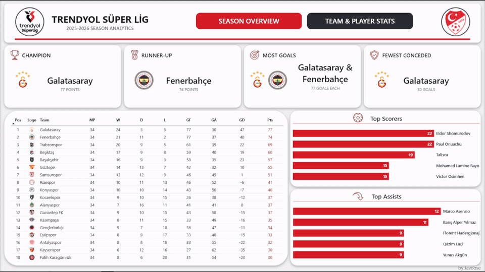
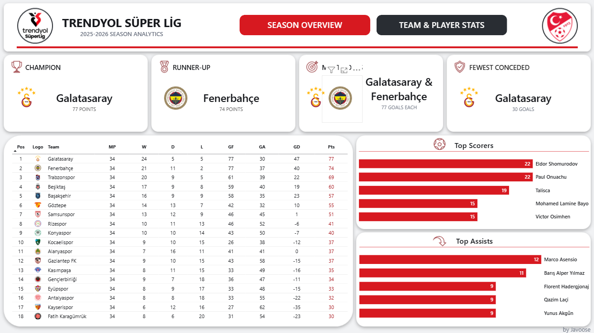
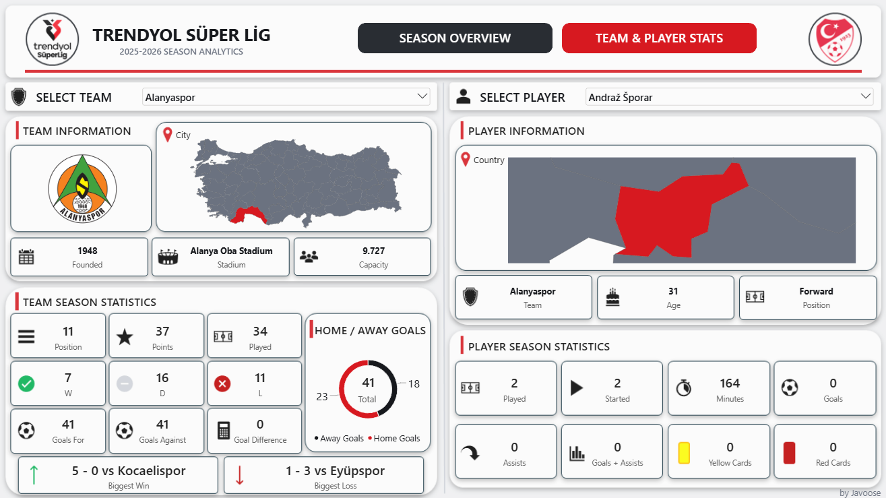

# Trendyol Süper Lig 2025–2026 | Data Analysis

An end-to-end data analytics project exploring the 2025–2026 Trendyol Süper Lig season using **Excel, Power Query, SQL Server, T-SQL, Power BI, DAX, and PowerPoint**.

This independent project covers data collection, cleaning, transformation, relational database management, SQL analysis, and interactive dashboard development.

## Dashboard Demo



## Project Overview

The goal of this project is to analyze team and player performance throughout the 2025–2026 Trendyol Süper Lig season and transform football statistics into meaningful insights through SQL queries and interactive Power BI visualizations.

The project focuses on three main areas:

- **Team Performance:** League standings, home and away results, attacking and defensive performance, and seasonal trends.
- **Player Performance:** Goal contributions, individual efficiency, team dependency, and hidden gems.
- **Match Analysis:** Results against different opponent groups, points dropped, and close-match performance.

## Technologies & Tools

| Technology | Purpose |
|---|---|
| Microsoft Excel | Data preparation and organization |
| Power Query | Data cleaning, transformation, and standardization |
| SQL Server | Relational database management |
| T-SQL | Data validation and analytical queries |
| Power BI | Interactive dashboard development |
| DAX | Measures, KPIs, and dynamic calculations |
| Microsoft PowerPoint | Dashboard background design and layout |

## Data Collection & Preparation

The project combines football data collected from multiple publicly accessible sources.

The data preparation process included:

1. Collecting player statistics, match results, and team information.
2. Organizing and preparing the datasets in Excel.
3. Cleaning, transforming, and standardizing data using Power Query.
4. Standardizing country names, player positions, stadium names, and team information into English.
5. Exporting prepared tables as CSV files and importing them into SQL Server.
6. Validating data consistency and establishing relational database constraints.
7. Developing SQL analyses and building an interactive Power BI report.

### Database Structure

The SQL Server database, `SuperLigDB`, contains the following main tables:

| Table | Description |
|---|---|
| `Players` | Player identities and personal information |
| `PlayerSeasonStats` | Individual player statistics for the season |
| `Teams` | Team information, stadiums, and locations |
| `TeamSeasonStats` | League standings and seasonal team statistics |
| `Matches` | Match schedules, results, and scores |
| `MatchTeamStats` | Match statistics organized from each team's perspective |

The database uses primary and foreign key relationships to maintain referential integrity.

## SQL Analysis

SQL Server and T-SQL were used to validate the datasets, calculate performance metrics, and identify meaningful patterns.

The analyses are divided into three categories.

### Team Performance Analysis

- Home vs Away Performance
- Attacking Performance
- Defensive Performance
- Performance Against Top 5 Teams
- First vs Second Half of the Season

### Player Performance Analysis

- Goal Contribution Efficiency
- Team Dependency
- Hidden Gems

### Match Analysis

- Points Dropped Against Bottom 5 Teams
- Close Match Performance

Each analysis is documented with a query output screenshot and its corresponding key findings.

**[View SQL Analysis & Key Findings](sql_analysis/README.md)**

**SQL Scripts:**
- [Data Validation](sql_analysis/queries/data_validation.sql)
- [Performance Analysis](sql_analysis/queries/analysis.sql)

## Power BI Dashboard

An interactive two-page Power BI report was developed to visualize league-wide performance and detailed team and player statistics.

The dashboard backgrounds were designed in **Microsoft PowerPoint** and imported into Power BI to create a consistent visual layout.

### Page 1 — Season Overview

The Season Overview page provides a league-wide summary, including:

- League champion and runner-up
- Highest-scoring teams and best defensive record
- Final league standings
- Top five goal scorers
- Top five assist providers



### Page 2 — Team & Player Stats

This page provides detailed team and player information through interactive slicers.

**Team Information & Performance**
- Team identity, location, founding year, colors, and stadium
- League position, matches played, wins, draws, and losses
- Goals scored, goals conceded, goal difference, and points
- Biggest win and biggest loss
- Home and away goal distribution

**Player Information & Performance**
- Age, nationality, position, and shirt number
- Matches played and started
- Minutes played
- Goals, assists, and total goal contributions
- Yellow and red cards



### Power BI Template

The report is available as a Power BI template (`.pbit`) containing the dashboard design, data model, Power Query transformations, and DAX measures without the imported dataset.

**[View Power BI Template](power_bi/trendyol_super_lig_2025_2026_season_analytics.pbit)**

To use the template interactively, the required data sources must be configured and loaded.

## Data Sources

The project uses data and geographical resources from the following sources:

- [FBref](https://fbref.com/) — Player statistics
- [Fixture Download](https://fixturedownload.com/results/super-lig-2025) — Match schedules and results
- [Transfermarkt](https://www.transfermarkt.com/) — Team and stadium information
- [Football Logos](https://football-logos.cc/turkey/) — Club logos
- [World GeoJSON](https://github.com/johan/world.geo.json) — World geographical data reference
- [Türkiye Province GeoJSON](https://github.com/ttezer/PowerBi/blob/main/%C4%B0ller/T%C3%BCrkiye_%C4%B0l.json) — Türkiye province map

### Data Availability

The original source datasets are not redistributed in this repository due to third-party data usage and redistribution considerations.

The Power BI report is provided as a template without the imported dataset. Dashboard screenshots and a demonstration GIF are included to showcase the completed report.

## Repository Structure

```text
.
├── power_bi/
│   ├── images/
│   │   ├── demo.gif
│   │   ├── season_overview.png
│   │   ├── season_overview_background.png
│   │   ├── team_player_stats.png
│   │   └── team_player_stats_background.png
│   └── trendyol_super_lig_2025_2026_season_analytics.pbit
│
├── sql_analysis/
│   ├── output_screenshots/
│   ├── queries/
│   │   ├── analysis.sql
│   │   └── data_validation.sql
│   └── README.md
│
└── README.md
```

## About This Project

This project was independently developed as a data analytics portfolio project to strengthen practical skills in data preparation, relational database management, SQL analysis, data modeling, DAX, and business intelligence reporting.

The project demonstrates an end-to-end analytical workflow, from collecting and preparing raw football data to producing SQL-based insights and interactive visualizations.
