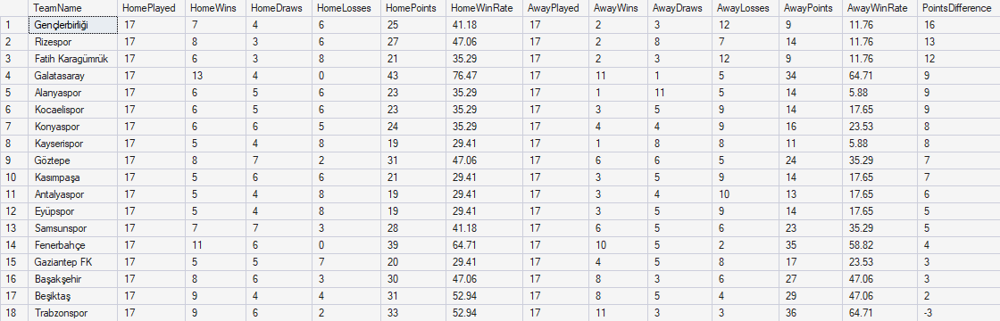
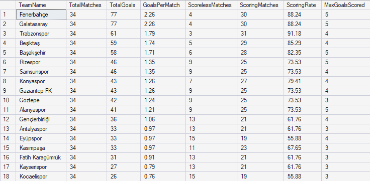
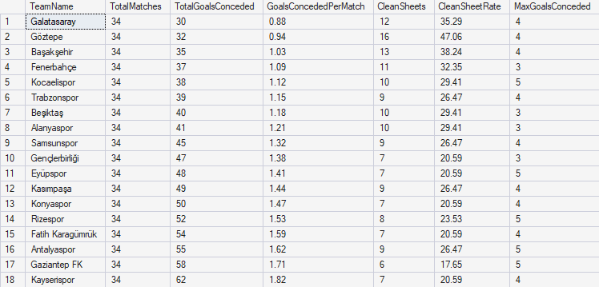
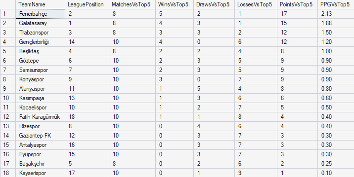
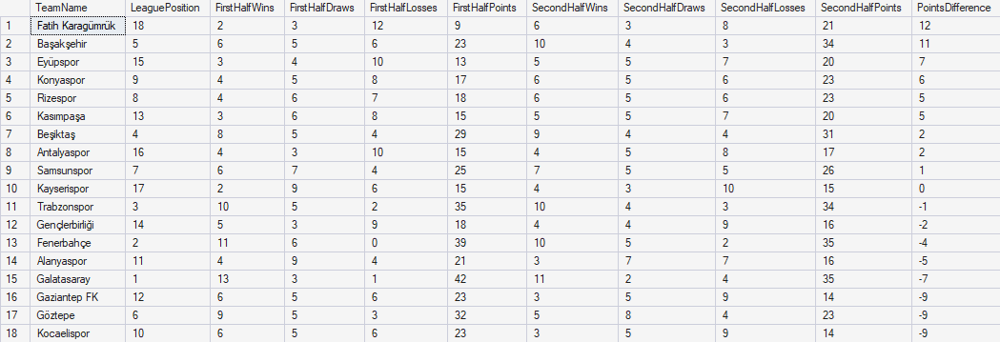
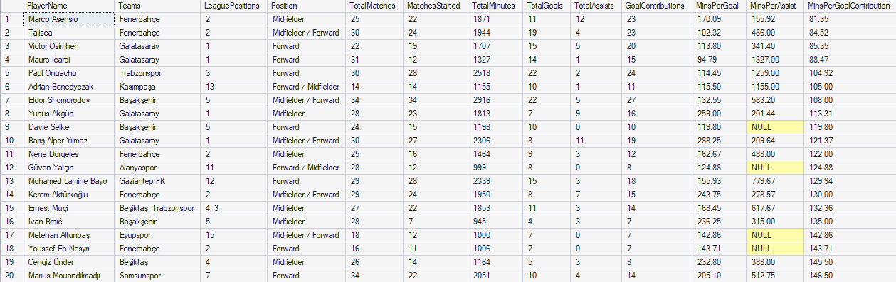
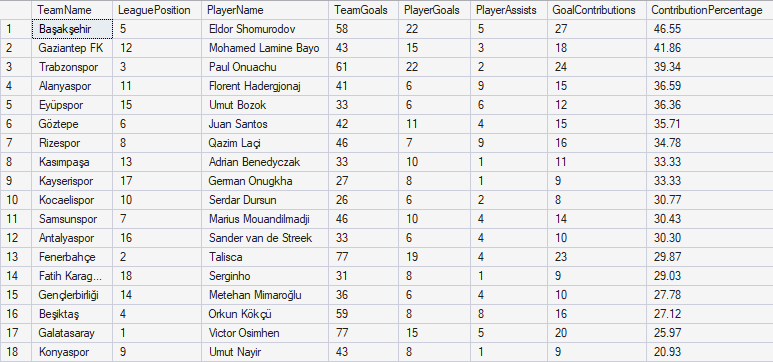
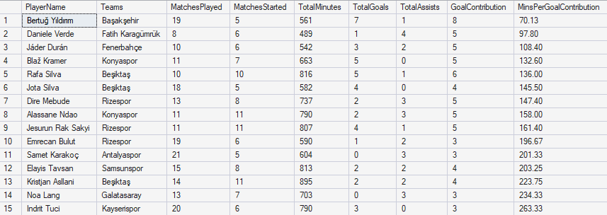
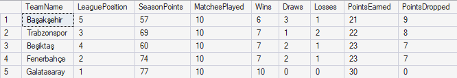
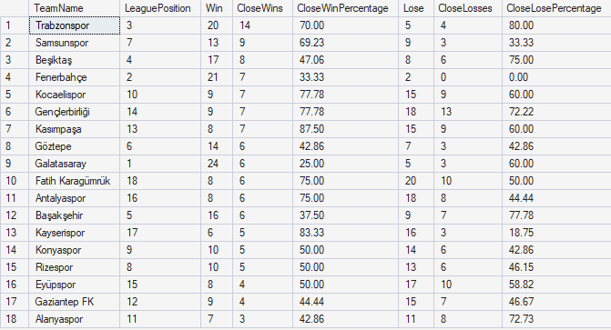

# SQL Analysis — 2025–26 Trendyol Süper Lig

This section presents SQL-based analyses of the 2025–26 Trendyol Süper Lig season, covering team performance, player statistics, and match results.

All analyses were performed using Microsoft SQL Server and T-SQL. Each analysis includes a screenshot of the query output followed by key findings derived from the results.

The SQL queries are available in the [queries](queries/) directory.

---

## 1. Team Performance Analysis

### 1.1 Home vs Away Performance

**Key Findings**

- **Gençlerbirliği** recorded the largest home-away points gap (+16), earning 25 points at home compared to just 9 away.
- **Galatasaray** collected the most home points (43), winning 13 of its 17 home matches.
- **Trabzonspor** achieved the highest away points total (36) and was the only team to collect more points away than at home.
- **Beşiktaş** demonstrated the most balanced home and away performance in the league, with just a 2-point difference between the two.
- **Galatasaray** and **Fenerbahçe** were the only teams to remain unbeaten at home throughout the season.

### 1.2 Attacking Performance

**Key Findings**

- **Fenerbahçe** and **Galatasaray** were the league's highest-scoring teams, each scoring 77 goals across 34 matches, averaging 2.26 goals per match.
- **Trabzonspor** demonstrated the highest scoring consistency, finding the net in 31 of its 34 matches (91.18%), despite scoring fewer total goals than Fenerbahçe and Galatasaray.
- **Kocaelispor** and **Eyüpspor** recorded the most scoreless matches (15 each), failing to score in 44.12% of their league fixtures.
- The highest number of goals scored by a single team in one match was 5, achieved by **Fenerbahçe**, **Galatasaray**, **Başakşehir**, **Rizespor** and **Alanyaspor**.

### 1.3 Defensive Performance

**Key Findings**

- **Galatasaray** had the best defensive record in the league, conceding just 30 goals across 34 matches (0.88 goals per match).
- **Göztepe** recorded the most clean sheets (16), keeping a clean sheet in 47.06% of its matches. Despite this, Göztepe conceded more total goals than Galatasaray (32 vs. 30).
- **Gaziantep FK** recorded the fewest clean sheets (6), conceding at least one goal in 28 of its 34 matches (82.35%).
- **Fenerbahçe**, **Beşiktaş**, **Alanyaspor** and **Gençlerbirliği** never conceded more than three goals in a single match throughout the season.

### 1.4 Performance Against Top 5 Teams

**Key Findings**

- **Fenerbahçe**, despite finishing second in the league, recorded the best performance against top-5 teams, collecting 17 points from 8 matches (2.13 points per game).
- **Gençlerbirliği**, despite finishing 14th, achieved 4 wins against top-5 teams, matching Galatasaray's win count and trailing only Fenerbahçe. The team collected 12 points from 10 matches (1.20 points per game).
- **Başakşehir**, despite finishing 5th in the league, recorded the worst points-per-game performance against top-5 teams, earning just 2 points from 8 matches (0.25 points per game) without a single victory.
- Every team suffered at least one defeat against top-5 teams, meaning no team remained unbeaten in these fixtures.

### 1.5 First vs Second Half of the Season

**Key Findings**

- **Fatih Karagümrük** showed the greatest improvement in the second half of the season, increasing its points total from 9 to 21 (+12). However, the team still finished 18th and was relegated.
- **Başakşehir** recorded the second-largest improvement, earning 34 points in the second half compared to 23 in the first (+11).
- **Galatasaray**, despite winning the league title, experienced a notable decline in second-half performance, collecting 35 points compared to 42 in the first half (-7).
- **Fenerbahçe** remained unbeaten throughout the first half of the season, recording 11 wins and 6 draws in 17 matches.
- **Kayserispor** had the most balanced points distribution between the two halves, collecting exactly 15 points in each, despite differences in its win, draw, and loss records.

---

## 2. Player Performance Analysis

### 2.1 Goal Contribution Efficiency

**Key Findings**

- **Marco Asensio** and **Talisca**, both midfield-oriented players, ranked first and second in goal contribution efficiency, averaging 81.35 and 84.52 minutes per contribution, respectively.
- **Galatasaray**, the league champions, had 4 players among the top 10 most efficient goal contributors, highlighting the attacking depth behind their title-winning season.
- **Mauro Icardi** recorded the best scoring efficiency (94.79 minutes per goal), despite starting only 12 matches.
- **Adrian Benedyczak** delivered 11 goal contributions in just 14 appearances, averaging 105 minutes per contribution.
- **Eldor Shomurodov** did not miss a single match throughout the entire 34-match season, starting every game and delivering 27 goal contributions (22 goals and 5 assists).

### 2.2 Team Dependency

**Key Findings**

- **Başakşehir** recorded the highest individual contribution ratio, with Eldor Shomurodov producing 27 goal contributions against 58 team goals (46.55%).
- **Konyaspor** recorded the lowest ratio, with Umut Nayir contributing 9 goals and assists combined against 43 team goals (20.93%).
- **No clear relationship** was observed between league position and the leading player's goal contribution ratio, with both high and low ratios appearing across different league positions.

### 2.3 Hidden Gems

**Key Findings**

- **Bertuğ Yıldırım** stood out with 8 goal contributions in just 561 minutes (70.13 minutes per contribution), surpassing even Marco Asensio's 81.35-minute rate from the previous analysis.

---

## 3. Match Analysis

### 3.1 Points Dropped Against Bottom 5 Teams

**Key Findings**

- **Galatasaray** won all 10 matches against the bottom five teams, dropping zero points. This consistency was particularly significant in their title-winning season, as they finished just 3 points ahead of Fenerbahçe.
- **Fenerbahçe**, the runners-up, dropped 7 points against the same group of opponents, highlighting how results against lower-ranked teams may have influenced the title race.

### 3.2 Close Match Performance

**Key Findings**

- **Trabzonspor** won 14 of their 20 matches by a single goal (70%), an unusually high proportion for a top-three team.
- **Galatasaray** had the lowest single-goal victory percentage (25%), followed by **Fenerbahçe** at 33.33%, suggesting that the top two teams generally secured more comfortable victories.
- **Kasımpaşa** and **Kayserispor** secured 87.50% and 83.33% of their wins by a single goal, respectively, indicating that even their limited wins were typically narrow.
- **Gençlerbirliği** lost 13 of their 18 matches by a single goal (72.22%), suggesting that many of their defeats were closely contested in terms of scoreline.
- **A general pattern emerged:** Higher-ranked teams tended to have lower single-goal victory percentages, while lower-ranked teams often relied more heavily on narrow wins, with notable exceptions such as Trabzonspor.
